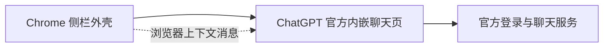

# ChatGPT 官方 Chrome 扩展：侧栏聊天实现核查

核查日期：2026-10-29。受查扩展名 `ChatGPT`，ID `hehggadaopoacecdllhhajmbjkdcmajg`，版本 `1.26.1020.11845`。

范围仅限本机该发行目录内的静态程序文件及官方使用文档。没有读取浏览器配置、Cookie、运行存储或真实凭据，没有执行扩展或发送模型问题。六份关键文件的大小与 SHA-256 见 [静态证据](验收证据/ChatGPT-1.26.1020.11845-static/sources.json)。

## 聊天承载方式

官方扩展创建本地侧栏外壳，在其中用 iframe 加载 `https://chatgpt.com/?surface=browser_side_chat`。聊天界面、模型选择、会话展示和生成请求由 iframe 中下载的官方网页程序处理。扩展壳通过消息传递浏览器上下文、选区、提示词预填、登录状态及会话地址。

这条结构不要求另有常驻 ChatGPT 顶层标签。登录或登录失效时可通过明确按钮临时打开官网认证标签，收到 iframe 的登录状态变化后清理对应认证标签。

与阅窗 0.9.1 相比，官方 iframe 就在侧栏内承载聊天；阅窗通过另一个官网标签中的客户端执行请求，再把文本转回自己的聊天界面。关闭那个标签会销毁阅窗所依赖的执行环境。我们此前遗漏了官方专用的内嵌界面入口。

## 程序证据

下表偏移均为从 0 起算的 UTF-8 字节偏移。压缩 JS 除特别注明外位于第 1 行。

| 文件 | 位置 | 核查结果 |
| --- | --- | --- |
| `codex-work-sidepanel.html` | 第 5 行 | CSP 允许 frame 来源为 `https://chatgpt.com` |
| `chunks/codex-work-sidepanel-CCrbBg1a.js` | 4382 附近 | 默认 `workModeUrl` 为上述 `browser_side_chat` 入口 |
| 同上 | 15538 附近 | 创建 iframe、设置 src 并放入侧栏容器 |
| 同上 | 15918 附近 | sandbox 保留脚本、同源及 Cookie / storage access 相关能力 |
| 同上 | 12916 附近 | 消息同时核对远端 origin 和 iframe 的 contentWindow |
| `content-scripts/codex-work-preload.js` | 660、794 附近 | 检查直接祖先为合法 Chrome 扩展 origin，设置侧聊环境标识 |
| `chunks/src-B7kAvDDE.js` | 15568—17500 附近 | 侧栏与 iframe 的上下文、预填、认证状态等消息协议 |
| `background.js` | 第 52 行、509021 附近 | 登录、登出等显式动作创建认证标签 |
| 同上 | 第 52 行、508930 附近 | 收到登录成功状态后清理对应认证标签 |

发行包的程序文本未发现独立对话端点、Sentinel 或发送校验实现。后台虽有会话查询和通用 backend-api 包装，已定位的用途为文件、设置、插件与浏览器控制隧道；这些包装本身不足以证明后台独立完成聊天生成。

## 桌面程序与普通聊天的区别

扩展确有 nativeMessaging，原生宿主名为 `com.openai.codexextension`。静态启动流程在构造原生桥后直接初始化侧栏，没有等待该桥连接成功。可确认聊天界面的加载与桌面浏览器控制通道分开；本次未实测桌面宿主完全不存在时的全部功能，不能据此扩大为所有能力均不需要桌面应用。

## 对阅窗的实际意义与未验证部分

可验证的候选是让阅窗的“对话”标签承载这个专用官方 iframe，其它阅读、收藏与设置标签仍由阅窗提供。它有机会满足日常聊天没有任何单独官网标签的要求，但需要接受对话区使用官方界面，原先自绘聊天组件的集成方式也随之改变。

发行包中的祖先 origin 检查接受结构合法的 Chrome 扩展 ID，没有在该处限定官方 ID。本机静态文件无法证明服务端对第三方扩展 origin 的嵌入策略，也无法证明第三方 Cookie、登录与聊天额度在阅窗里均可正常工作。**当前仅确认官方自身的结构；尚未验证阅窗可直接使用这个入口。**

验证应使用阅窗自己的扩展 ID，遵守服务器与浏览器的嵌入和登录策略。不得复制官方 manifest key、冒充官方扩展 ID、移除安全响应头或把 iframe onload 当成聊天成功。

独立匿名 offscreen 试验此前使用普通首页，且网络连接失败；该结果不能证明这个专用入口允许或禁止嵌入。后续需要针对专用入口单独验证。

官方使用说明：[Browser extension](https://learn.chatgpt.com/docs/chrome-extension)。说明确认侧聊入口、会话可在应用与浏览器间继续，以及登录和网站权限的用户流程；上述内部承载方式来自本轮静态代码核查。
