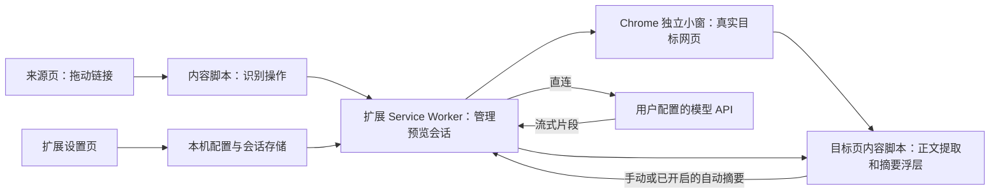

# 自用网页阅读助手：需求分析与初版技术方案

版本：v0.1 草案  
日期：2026-10-25  
状态：历史初版设计稿，保留原方案。第一阶段已由用户于 2026-10-26 确认验收通过；当前交付与确认见 [本轮验收记录](页内预览与全文摘要验收.md)。

## 1. 产品目标

围绕“查资料—筛选链接—理解内容—继续阅读”提供辅助，保留用户习惯的右键 Google 搜索路径。衡量价值时，重点看能否更快找到可用内容、保持原文阅读位置，以及减少无用标签页。

典型使用流程：

> 阅读技术文章或外语内容 → 遇到疑问后搜索 → 拖动搜索结果或文章引用 → 小窗查看原网页 → 按需读取中文摘要 → 决定继续阅读或关闭。

## 2. 已确认的需求与边界

| 项目 | 对话中确认的内容 |
| --- | --- |
| 使用者 | 个人自用的 Chrome 扩展 |
| 数据保存 | 插件侧数据只留本机，无自建云端存储 |
| 模型接入 | 用户填写自己的 API Key，扩展直连用户指定的模型服务 |
| 阅读场景 | 技术文章、外语内容，快速查阅陌生词语、概念和难懂段落 |
| 现有习惯 | 习惯右键 Google 搜索；新增功能应帮助实际查阅和筛选过程 |
| 重点方向 | 链接拖动预览、可开启自动总结，值得作为首版核心验证 |

数据边界：正文和问题会按操作发送到配置的模型 API。插件无服务端或云数据库；模型服务商如何保留请求，需要依据所选接口规则确认。使用本机模型接口时，请求可留在本机。

## 3. 初版设计建议

下面是本方案的推荐取舍，尚不等同于用户逐项确认。

| 决策 | 初版建议 | 理由 |
| --- | --- | --- |
| 第一阶段主功能 | 链接预览与手动／自动摘要 | 可以单独安装并投入实际阅读流程 |
| 预览形式 | Chrome 独立小窗口，加载真实目标网页 | 保留页面样式、交互及通常的浏览器登录上下文 |
| 摘要显示 | 预览网页内可折叠的摘要浮层 | 原文和摘要可以一起查看，减少额外窗口 |
| 自动摘要 | 提供开关，默认关闭 | 由用户决定何时开始模型调用 |
| 接口协议 | 首期适配一个 Chat Completions 兼容接口 | 用用户自己的服务完成一条稳定链路，后续可替换适配器 |
| Key 保存 | 默认仅浏览器会话内使用；可选择本机记住 | 兼顾自用便利和持久化选择 |
| 历史与缓存 | 无永久聊天历史；仅会话级摘要去重 | 首期控制数据量和重复请求 |
| 权限 | 首次设置可一次启用 HTTPS 网页访问 | 跨站拖动识别、目标正文读取与模型直连需要相关域权限 |

独立小窗是初版实现选择。Sider 的页内浮层体验可作为后续增强。正文阅读模式也可以追加，界面应明确标注“正文预览”，避免与真实原网页混淆。

## 4. 功能范围

### 第一阶段：链接预览与摘要

- 配置 API Base URL、模型标识、API Key，提供连接测试。
- 在已授权的普通网页识别链接拖动，打开或复用一个预览小窗。
- 预览加载真实链接目标；保留来源页面的 URL 和滚动位置。
- 显示目标地址，提供“在普通标签页打开”和关闭入口。
- 读取预览目标当前已加载的正文，生成简短中文摘要。
- 支持手动总结、自动总结开关、停止生成和明确的失败状态。
- 同一时刻只运行一个摘要任务，快速切换链接时取消旧任务。
- 设置在本机保存；Key 保存方式可选；会话缓存可清理。

### 后续增强

- 右键“结合本文解释”：携带选中文字和附近段落，返回语境释义、概念解释或翻译。
- 页内浮层预览、窗口位置记忆、按站点启停。
- 将搜索问题显式带入摘要，帮助判断目标文章与问题的相关性。
- 正文阅读模式、更多模型协议、本地收藏和导出。

### 当前暂缓

通用聊天工作台、永久聊天历史、多模型同时回答、PDF／OCR、视频转写、浏览器自动填表及跨站任务代理。首期无需账号、支付或云同步模块。

## 5. 技术架构

推荐技术栈：Manifest V3、TypeScript、Vite、轻量 DOM UI；Readability 用于正文提取。需要 Markdown 时，使用随扩展打包的渲染器与 DOMPurify。所有可执行代码随扩展本地打包。

模块职责：

| 模块 | 职责 |
| --- | --- |
| 来源页内容脚本 | 识别普通链接的真实拖动操作，维护预览投放区；不持有 Key |
| 预览管理器 | 创建／复用小窗，记录来源与目标标签页，处理关闭和导航 |
| 目标页内容脚本 | 克隆 DOM 并提取正文，以 Shadow DOM 隔离摘要浮层样式；不持有 Key |
| 模型适配器 | 在扩展后台构造请求、鉴权、解析流式结果、处理取消和错误 |
| 设置与存储 | 管理接口配置、Key 保存选择和自动摘要开关 |
| 任务管理器 | 以预览会话、目标文档和请求 ID 隔离异步结果，管理会话去重 |

### 5.1 链接拖动与真实网页预览

1. 初版建议在链接拖动时显示“预览”投放区；拖入并松开后触发。普通点击、文本选择、拖向标签栏等行为保留。
2. 后台校验链接协议和来源会话，创建 `chrome.windows.create({type: "popup", url: targetUrl})`。首期全局只维护一个预览小窗，后续预览复用小窗并更新来源会话。
3. 保留原网页自身的加载与脚本执行；通过已授权域的内容脚本处理摘要。真实页面加载仍会产生该网站正常的资源请求。
4. 小窗内点击链接继续导航时清空旧摘要，自动摘要只针对本次明确拖动打开的目标。后续导航可手动再次总结，避免自动遍历链接。
5. 新链接替换目标时取消旧任务；关闭小窗后释放预览会话和任务连接。

采用顶层窗口可以避开跨站 iframe 的 `X-Frame-Options`／CSP `frame-ancestors` 嵌入限制。它仍受普通网页加载、登录、网络和网站自身行为影响；不会解除付费墙、验证码或访问控制。

### 5.2 正文提取与摘要输入

- 从实际预览目标的已加载 DOM 提取标题、最终 URL、正文和可用代码块，排除扩展自身 UI；保留原 DOM。
- Readability 用于文章类页面；`article`／`main` 可作为显式结构的补充。正文不足时显示“未取得足够正文”，保留原网页与重试入口。
- 初版建议对 DOM 变更做短暂稳定检测，并设置提取截止时间；后加载内容可以由“重新读取并总结”刷新。
- 登录表单、编辑框、密码字段不作为默认输入；识别到明显登录／验证页面时暂停自动摘要，提示完成访问后重试。
- 建议初始正文长度上限为 24,000 字符；超出时显示“仅总结已截取内容”，不声称覆盖全文。接口实测后再调整。
- 默认输出：一句主题概括、3—5 条重点，约 120—250 字中文，保留关键术语；输入不足时说明不足。
- 网页正文作为待分析材料处理；首期模型没有网页操作工具。

这些长度与等待时间是初始工程参数，需要在实现阶段通过代表页面调整。

### 5.3 模型请求与任务生命周期

- 第一阶段使用一个经过实测的 Chat Completions 兼容服务，配置 Base URL、Key、模型标识。各家服务的兼容程度需要验证，不承诺任意接口填入即用。
- API 请求在扩展后台发送，Key 只放在该配置服务的鉴权头中；目标网页读取与模型调用使用独立网络逻辑。
- 使用流式文本响应，支持 AbortController；模型请求禁止自动跟随重定向，避免接口配置发生隐式跳转。
- 对于支持的服务，显式请求不保存生成记录；该参数无法替代服务商自身的数据留存规则。
- 预览页通过 runtime Port 接收结果；有效任务期间每 20 秒发送一次状态查询，模型暂未输出时也发送。任务完成、取消或连接断开后立即停止。建议连接／响应头等待上限 25 秒、总任务上限 120 秒，并对长期无进展进行超时处理。
- MV3 后台可被终止。保存可恢复的会话元数据；端口断开或后台重启时将任务标为中断，允许手动重试，不自动重复扣费。仅打开 Port 无法保证后台持续存活。
- 以 `previewId + tabId + documentId/导航版本 + requestId` 校验每条结果。A 页的延迟输出不能覆盖 B 页摘要。
- 同任务合并重复点击；完成摘要可按 URL、正文哈希和配置指纹做会话级缓存。指纹覆盖接口地址、模型、输出语言和提示版本；接口或 Key 配置改变时清空缓存。建议上限 20 项，手动刷新可重新请求。
- 401／403、429、模型不存在、格式不兼容、超时等分别给出可操作提示，不自动切换服务商或模型。

### 5.4 本机数据与权限

| 数据 | 存储建议 |
| --- | --- |
| 接口地址、模型名、开关 | `chrome.storage.local` |
| 默认会话 Key | `chrome.storage.session` |
| 主动选择记住的 Key | `chrome.storage.local`；说明属于本机持久化，不声称操作系统保险库级加密 |
| 预览元数据、会话摘要缓存 | `chrome.storage.session` 或受控内存，浏览器会话结束后清空 |
| 原文、聊天历史 | 首期不做永久保存 |

在写入 Key 前，对 local／session 存储设置 `TRUSTED_CONTEXTS`，Key 读写仅在设置页和扩展后台完成。设置导出排除 Key；不将 Key 写进网页、URL、内容脚本消息和日志，不使用 `storage.sync`。

首期建议以 Chrome 120+ 为兼容基线，基本权限为 `storage`、`scripting`。HTTPS 网站访问声明为可选 host 权限，在设置页通过一次明确的“启用网页预览”操作授予，拒绝时显示功能未启用。若只授权部分网站，来源页和目标页都要覆盖；`activeTab` 无法自动覆盖链接的另一域名。

模型域也需对应 host 权限。初版支持 HTTPS 接口，开发和本机模型可以按需启用 localhost／127.0.0.1 的 HTTP 权限；普通 HTTP 网页支持后续再补。

消息按角色校验：预览创建仅接受已授权来源标签页；提取、总结和停止仅接受当前预览目标及文档；配置修改仅接受扩展设置页。标签页和文档身份取自浏览器提供的 `sender`，不信任消息自报的身份。网页无法通过任意 URL 消息把后台变成通用鉴权代理。摘要输出采用安全文本／受限 Markdown 渲染。

权限撤销时取消相关任务、解除目标会话并停用已注入脚本的相关动作；移除注册并不会自动删除已经注入的脚本。后续提取前重新验证最终目标域权限。

摘要浮层以 Shadow DOM 隔离样式，这层隔离不作为安全边界。浮层仍位于目标网页 DOM，该网页可能读取浮层中的摘要；Key 始终不进入该 DOM。如果后续需要更强的显示隔离，可改用扩展自有面板。

### 5.5 首期网站兼容边界

- 首期以普通 HTTPS 技术文章、文档和外语文章为验收对象。
- 原网页预览与摘要独立：页面能正常打开但正文无法提取时，保留浏览能力并说明原因。
- 页面导航、登录跳转或重定向后，以最终页面重新验证权限和正文；不沿用旧摘要。
- `chrome://`、Chrome Web Store 等受限页面、PDF、视频页和复杂在线编辑器不作为首期摘要支持目标。
- 页内跨域 iframe、封闭 Shadow DOM 或仅图像呈现的正文，首期不承诺提取。

## 6. 第一阶段与后续顺序

第一阶段 M1：交付“链接拖动—真实网页小窗—手动／自动摘要—关闭返回”的完整闭环。它可单独使用，无需依赖后续聊天或划词功能。具体操作和通过标准见《第一阶段验收》。

后续优先级：先增加右键语境解释，再根据实际体验决定是否投入页内浮层、阅读模式和更多接口。若 M1 无法减少查阅时的跳转和标签页负担，应先调整交互再扩展功能。

## 7. 实现前需要实测的事项

- 用户实际使用的模型服务、接口协议和模型标识；Key 在本机配置，不需要发送到聊天。
- 当前 Chrome 版本、典型文章页面及常见网站的拖动行为。
- 独立小窗＋摘要浮层的阅读体验，以及原页浮层是否值得追加。

这些项影响适配与体验，不影响本需求文档和 M1 验收范围的独立定义。

## 8. 技术依据

以下来源用于核对浏览器和 API 能力；本方案不声称掌握 Sider 的内部实现。

- [Chrome windows：创建和管理窗口](https://developer.chrome.com/docs/extensions/reference/api/windows)
- [Chrome scripting：脚本注入和 host 权限](https://developer.chrome.com/docs/extensions/reference/api/scripting)
- [Chrome 扩展跨域请求](https://developer.chrome.com/docs/extensions/develop/concepts/network-requests)
- [Chrome 可选权限](https://developer.chrome.com/docs/extensions/reference/api/permissions)
- [Chrome storage：local、session、sync 和访问级别](https://developer.chrome.com/docs/extensions/reference/api/storage)
- [Chrome MV3 Service Worker 生命周期](https://developer.chrome.com/docs/extensions/develop/concepts/service-workers/lifecycle)
- [Chrome 扩展消息通信](https://developer.chrome.com/docs/extensions/develop/concepts/messaging)
- [MDN：CSP frame-ancestors](https://developer.mozilla.org/en-US/docs/Web/HTTP/Reference/Headers/Content-Security-Policy/frame-ancestors)
- [Mozilla Readability](https://github.com/mozilla/readability)
- [OpenAI Docs：Chat Completions 请求与流式参数](https://developers.openai.com/api/reference/resources/chat/subresources/completions/methods/create)
